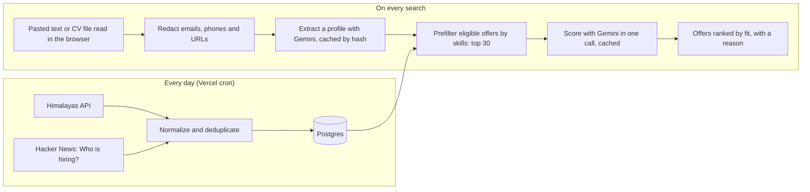

# Radar de ofertas IT

Remote IT job offers, ranked by how well they fit your profile.

**Live demo:** [radar-ofertas-it.vercel.app](https://radar-ofertas-it.vercel.app) (Spanish and English)

Paste your CV or a description of your experience, or load it from a PDF, DOCX or TXT file, and pick the country you live in. The app shows the remote offers that accept people from that country, ordered by a 0–100 fit score with a short reason for each one. Offers that appeared since your last search are marked as new.

## How it works



1. **Ingestion.** Two daily cron jobs pull offers from the Himalayas API and from the Hacker News "Who is hiring?" thread. Offers are normalized to one model, deduplicated across sources and kept only while they are active.
2. **Profile.** The text is redacted, hashed and turned into a structured profile (skills, roles, languages and a short summary) by Gemini. The same text never costs a second call.
3. **Prefilter.** A deterministic ranking by skills, with the title weighing more than the description, keeps the 30 most promising offers for the country. Everything else never reaches the model.
4. **Scoring.** Gemini scores the 30 candidates in a single call with a structured JSON output validated by Zod. Scores are cached per profile and offer, so repeating a search is free.

If the daily quota runs out halfway, the offers already scored are shown first and the rest are listed by how many of your skills they mention, with a notice that says why.

## Privacy and limits

- **The CV is never stored.** Only the redacted text is sent to Gemini, and only the structured profile is saved, keyed by a hash. A CV file is read in the browser: the file itself never reaches the server.
- **Spending has a ceiling.** Every Gemini call uses one unit of a daily counter in Postgres. Visitors stop at a lower daily limit than the owner, and each connection gets 5 searches per day. IPs are kept only as an HMAC with a secret, and IPv6 addresses are grouped by their /64 block.
- **Owner mode.** A secret unlocks the full daily budget through a signed, `httpOnly` cookie that lasts 30 days.
- **Retention.** A daily cron deletes usage counters after 3 days, profiles 30 days after their last use and scores 30 days after they were created.

## Architecture

A single Next.js package split in layers. ESLint import rules keep the dependencies pointing inwards.

| Layer                | What lives there                                                                    |
| -------------------- | ----------------------------------------------------------------------------------- |
| `src/domain`         | Pure rules with no I/O: the profile, the prefilter, redaction, offer rules          |
| `src/application`    | Use cases (extract a profile, match offers, search) and the ports they need         |
| `src/infrastructure` | Postgres repositories, the Gemini client, the job sources, crons, auth, rate limits |
| `src/app`            | Routes, server actions, components and the ES/EN dictionaries                       |

More detail in [`docs/spec.md`](docs/spec.md) and [`docs/data-model.md`](docs/data-model.md).

## Decisions

Every decision that shapes the code has an Architecture Decision Record:

| ADR                                                             | Decision                                                               |
| --------------------------------------------------------------- | ---------------------------------------------------------------------- |
| [0001](docs/adr/0001-layered-architecture.md)                   | Layered architecture in a single package                               |
| [0002](docs/adr/0002-neon-pg-docker-dev-only.md)                | Neon Postgres, `pg` with explicit SQL, and Docker for development only |
| [0003](docs/adr/0003-url-based-i18n.md)                         | URL-based i18n with hand-made dictionaries                             |
| [0004](docs/adr/0004-own-migration-runner.md)                   | Own SQL migration runner                                               |
| [0005](docs/adr/0005-job-sources-and-ingestion.md)              | Job sources and daily ingestion                                        |
| [0006](docs/adr/0006-offer-deduplication.md)                    | Offer deduplication                                                    |
| [0007](docs/adr/0007-profile-extraction-and-offer-scoring.md)   | Profile extraction and offer scoring                                   |
| [0008](docs/adr/0008-abuse-limits-owner-mode-and-retention.md)  | Abuse limits, owner mode and data retention                            |
| [0009](docs/adr/0009-loading-the-cv-from-a-file.md)             | Loading the CV from a file                                             |
| [0010](docs/adr/0010-measuring-the-prefilter-and-the-scorer.md) | Measuring the prefilter and the scorer                                 |

## Tech stack

- **Next.js 16** (App Router, server actions) with **React 19** and strict **TypeScript**
- **PostgreSQL**: Neon in production, Docker locally; `pg` with explicit SQL and an own migration runner, no ORM
- **Gemini 3.5 Flash-Lite** through the Interactions API, with structured output checked by **Zod**
- **pdf.js** and **mammoth** to read CV files in the browser
- **Vitest** for unit, integration and smoke tests
- **Vercel** for hosting and cron jobs

## Running it locally

You need Node.js 20.9 or newer and Docker.

```bash
npm install
docker compose up -d
cp .env.example .env.local
npm run db:migrate
npm run dev
```

Fill in `.env.local` before running the migrations. `.env.example` lists every variable; the main ones are:

| Variable                                 | Used for                                                                                            |
| ---------------------------------------- | --------------------------------------------------------------------------------------------------- |
| `DATABASE_URL`, `DATABASE_URL_UNPOOLED`  | The app and the migrations. The Docker database listens on port 5435                                |
| `CRON_SECRET`                            | Protects the cron routes                                                                            |
| `GEMINI_API_KEY`, `GEMINI_MODEL`         | Profile extraction and scoring. Without them the app runs and says that AI search is not configured |
| `GEMINI_DAILY_LIMIT`, `DEMO_DAILY_LIMIT` | Daily Gemini budget for the owner and for visitors                                                  |
| `OWNER_SECRET`                           | Signs the owner session                                                                             |
| `IP_HASH_SECRET`                         | Hashes visitor IPs for the rate limit                                                               |

Open [localhost:3000/es](http://localhost:3000/es). The database starts empty: load offers by calling the cron routes yourself.

```bash
curl -H "Authorization: Bearer <your CRON_SECRET>" http://localhost:3000/api/cron/ingest/himalayas
curl -H "Authorization: Bearer <your CRON_SECRET>" http://localhost:3000/api/cron/ingest/hackernews
```

## Scripts

| Script                                   | What it does                                                                                  |
| ---------------------------------------- | --------------------------------------------------------------------------------------------- |
| `npm run dev` / `build` / `start`        | Next.js                                                                                       |
| `npm run lint` / `typecheck`             | ESLint and `tsc --noEmit`                                                                     |
| `npm test`                               | Unit tests                                                                                    |
| `npm run test:integration`               | Tests against the Docker database                                                             |
| `npm run test:smoke`                     | Calls the real Gemini API with a synthetic CV (spends quota)                                  |
| `npm run db:migrate` / `db:migrate:prod` | Applies the SQL migrations locally or to production                                           |
| `npm run check:prod -- <url>`            | Checks a deployment without spending quota: health, pages, 404, `noindex` and cron protection |
| `npm run eval:*`                         | The measurement workflow, described in [`eval/README.md`](eval/README.md)                     |

## Measuring the scorer

The [`eval`](eval/README.md) folder measures whether the prefilter and Gemini rank offers well: three fictional personas, 135 labeled offers, recall of the prefilter, Spearman correlation of the scorer, and a decision rule fixed before running ([ADR-0010](docs/adr/0010-measuring-the-prefilter-and-the-scorer.md)).

- The labels come from Claude Opus 5.5 used as a judge. A human check of 30 of them agreed only weakly (weighted kappa 0.32, below the 0.60 set in advance), so the results measure agreement with that judge, not with a person.
- Against the judge, Gemini's order reaches a Spearman of 0.58, against 0.02 for the prefilter alone.
- Batches of 5, 10 and 30 offers rank equally well within the noise, so the app now scores the 30 candidates in one call instead of three.

## Known limitations

- Only two sources. Offers from Hacker News are parsed from free text, so some fields can be missing.
- Country names are shown in English in both languages.
- The redaction catches emails, phone numbers and URLs, but not names, addresses or employers. The interface warns that the text is sent to Google.
- A scanned PDF has no text to read; it has to be pasted.
- People behind the same IP (an office, a university) share the 5 visitor searches per day.
- Google Drive is reachable through the phone's file picker or Drive for desktop, not through a dedicated integration.
